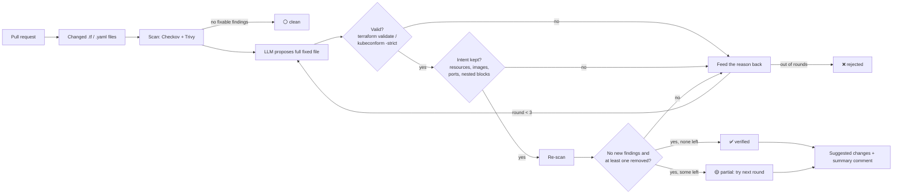

# EASE-Bot 🛡️

**Verified LLM fixes for Terraform and Kubernetes misconfigurations, right on your pull request.**

EASE-Bot is a GitHub Action. When a pull request changes `.tf` or Kubernetes `.yaml` files it:

1. scans only the changed files with **Checkov** and **Trivy**, and marks which findings the PR introduced;
2. asks an LLM (Groq's free tier, `openai/gpt-oss-120b`, by default) for a fix;
3. **refuses to show the fix unless it survives a verifier**: the file must still validate
   (`terraform validate` / `kubeconform -strict`), keep every resource, container, image and port it had,
   add **no** new findings, and remove at least one;
4. if a candidate is rejected, tells the model *why* and lets it try again (up to 3 rounds);
5. posts the survivors as GitHub **suggested changes** (one click: *Commit suggestion*) plus one summary
   comment with a verdict per file: ✅ verified, 🟡 partial, ❌ rejected.

> Why the verifier? In my own study of LLM repair for IaC (499 Kubernetes and Terraform files),
> **52.9 % of the fixes from `gpt-oss-120b` that made the scanner pass still failed to deploy or changed
> what the file does** (11.7 % for Gemini). A scanner going green is not proof the fix is safe.
> EASE-Bot puts that lesson into CI.

## Live demo

- Demo repository: https://github.com/shohrabniaz/ease-bot-demo
- Demo pull request with the bot's real comments: _see the demo repo's pull requests_

## Quick start (GitHub Actions)

1. Get a free Groq API key at https://console.groq.com and add it to your repo as the secret `GROQ_API_KEY`.
2. Add `.github/workflows/ease-bot.yml`:

```yaml
name: EASE-Bot
on:
  pull_request:
    paths: ["**/*.tf", "**/*.yaml", "**/*.yml"]

permissions:
  contents: read
  pull-requests: write

jobs:
  ease-bot:
    runs-on: ubuntu-latest
    steps:
      - uses: actions/checkout@v4
        with:
          ref: ${{ github.event.pull_request.head.sha }}
      - uses: shohrabniaz/ease-bot@v0.1.0
        with:
          groq-api-key: ${{ secrets.GROQ_API_KEY }}
```

### Inputs

| Input | Default | Meaning |
|---|---|---|
| `groq-api-key` | – | Groq key (pass from a secret) |
| `llm` | `groq` | `groq`, `openai-compatible` (set `EASEBOT_BASE_URL`), or `mock` (offline, no key) |
| `model` | `openai/gpt-oss-120b` | model id |
| `scanners` | `checkov,trivy` | scanners to run |
| `max-rounds` | `3` | repair rounds per file |
| `max-files` | `10` | IaC files checked per PR |
| `defer-checks` | `default` | rules reported but never auto-fixed (see below); `none` or a comma list |
| `tool-validate` | `true` | run `terraform validate` and `kubeconform -strict` on every candidate |
| `fail-on` | `none` | `rejected` or `findings` to fail the check |

Outputs: `verified`, `partial`, `rejected` (file counts).

## Run it locally

```bash
pip install -e ".[scan,test]"
easebot scan demo/ --llm mock --no-tool-validate     # offline, no API key
export GROQ_API_KEY=...                              # never commit this
easebot scan demo/ --markdown report.md --json report.json
easebot scan infra/ --write                          # apply verified/partial fixes in place
easebot scan infra/ --base origin/main               # mark findings introduced since main
python -m pytest -q
```

Install `terraform` and [`kubeconform`](https://github.com/yannh/kubeconform) to get the full validity
check locally; without them EASE-Bot says the file was only partly checked and never counts that as a pass.

## How it works



Code map:

| File | Role |
|---|---|
| `easebot/scanners.py` | Checkov and Trivy adapters → one `Finding` type |
| `easebot/llm.py` | Groq / OpenAI-compatible client with retries; offline `mock` |
| `easebot/validate.py` | validity (`terraform validate`, `kubeconform -strict`) and intent checks |
| `easebot/repair.py` | the scan → fix → verify → feedback loop and verdicts |
| `easebot/suggest.py` | turns a fixed file into GitHub suggestion hunks that fit the PR diff |
| `easebot/github.py`, `cli.py` | PR files, review with suggestions, one sticky summary comment |
| `action.yml` | composite action; Trivy and kubeconform downloads are pinned and checksum-verified |

### Things the verifier has caught in testing

- `gpt-oss-120b` "fixed" a Deployment by putting container-only fields (`privileged`,
  `capabilities`, `readOnlyRootFilesystem`) into the **pod** security context. Checkov and Trivy were both
  happy, but `kubeconform -strict` rejects it (those fields do not exist there), so EASE-Bot now refuses that
  candidate and sends the schema error back to the model.
- To silence an "SSH open to 0.0.0.0/0" finding the model **deleted the ingress rule**. The scanner passed,
  but that changes behaviour. The intent check now rejects deleted blocks, and with that rule the model
  restricted the rule to a new `ssh_allowed_cidr` variable instead.
- To satisfy "security group must be attached", the model **invented an EC2 instance with a made-up AMI**.
  Checks like that now sit in the *deferred* list.

### Deferred checks

Some findings need a decision or a value no model can know: a second bucket for access logs, a replication
region, a KMS key, an image digest, a trusted registry, which resource a security group belongs to.
EASE-Bot reports them under "Needs a human decision" but never asks the model to fix them
(`CKV2_AWS_5, CKV2_AWS_61, CKV2_AWS_62, CKV_AWS_144, CKV_AWS_145, CKV_AWS_18, CKV_AWS_189, CKV_K8S_43,
CKV2_K8S_6, AWS-0027, AWS-0089, AWS-0132, KSV-0125`). Override with `defer-checks`.

## Limits (please read)

- **Verified means "passed these checks", not "safe to deploy".** EASE-Bot runs `terraform validate`, not
  `plan` against your real providers, and `kubeconform` schema checks, not a server-side dry run or your
  admission policies. A hardened file can still break the app at runtime (for example a read-only root
  filesystem for a program that writes to `/tmp`). Review every suggestion.
- The intent check is structural (resource addresses, Kubernetes objects, container names, images, ports,
  and nested Terraform blocks). It cannot tell if a changed value still means what you meant.
- Terraform files are validated together with the other `.tf` files in the same folder. If the original
  file does not validate in isolation (remote modules, missing variables), validation is marked
  *skipped* rather than passed.
- Files over 14,000 characters are skipped to stay inside free-tier token limits.
- On pull requests from forks GitHub gives a read-only token and no secrets, so the bot cannot comment there.
- LLM output varies between runs. The verifier makes bad fixes visible; it does not make every fix possible.
- Your changed file content is sent to the LLM provider you configure. Do not use it on files that contain
  secrets (they should not be in IaC anyway).

## Security notes

- The API key is read from the environment only. It is never printed, written to reports, or put in prompts.
- Action inputs reach the script through environment variables, not string interpolation.
- The workflow token needs only `contents: read` and `pull-requests: write`.

## Licence

MIT © 2026 Shohrab Hossen Niaz
